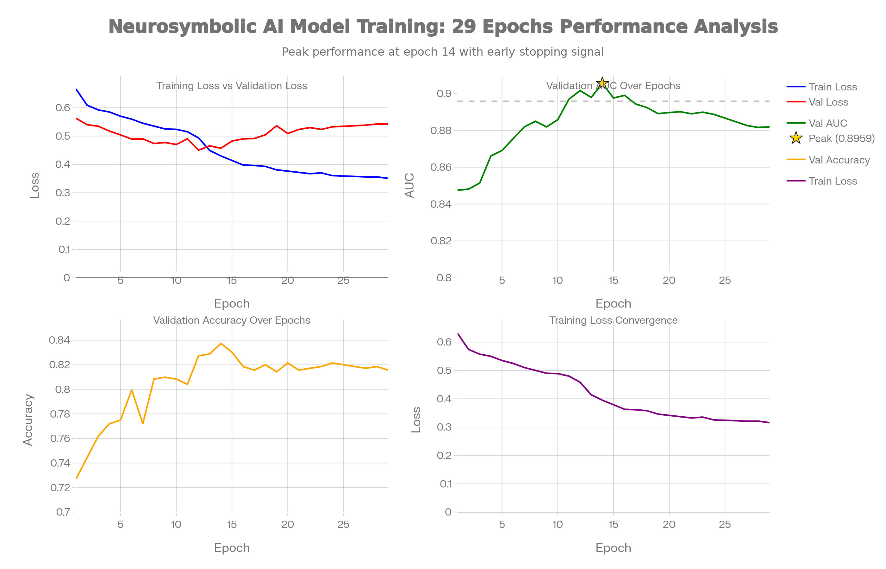

<div align="center">

# 🧠 NeuroGraph BioAI

### Neurosymbolic Drug Repurposing Platform

*Graph neural network scores + symbolic reasoning over a biomedical knowledge graph, with explanations you can read.*


[](https://opensource.org/licenses/MIT)
[](https://www.python.org/downloads/)
[](https://reactjs.org/)
[](https://fastapi.tiangolo.com/)
[](https://neo4j.com/)
[](https://pytorch.org/)

**Live demo:** https://biograph-seven.vercel.app *(free hosting: the first load can take about a minute while the server wakes up)*

</div>

> **Research prototype.** Scores indicate pattern similarity in a knowledge graph, not clinical efficacy. Nothing here is medical advice or a validated treatment recommendation.

---

## Contents

[Overview](#-overview) · [Features](#-features) · [Architecture](#-architecture) · [Data](#-data-hetionet-in-neo4j) · [How predictions work](#-how-predictions-work) · [The GNN](#-the-gnn-model) · [Tech stack](#-tech-stack) · [Getting started](#-getting-started) · [Project structure](#-project-structure) · [API reference](#-api-reference) · [Training](#-training-the-model) · [Deployment](#-deployment) · [Testing](#-testing) · [Troubleshooting](#-troubleshooting) · [Known limitations](#-known-limitations)

---

## 🎯 Overview

Drug repurposing looks for new uses of drugs that are already approved, which is faster and cheaper than discovering a new drug. NeuroGraph BioAI stores biomedical knowledge (drugs, diseases, genes, pathways) as a graph, scores drug-disease pairs with a graph neural network, and then looks for **paths in the graph that explain the score**, for example *"this drug binds a gene that is associated with the disease"*.

| | Typical black-box model | NeuroGraph BioAI |
|---|---|---|
| Output | A score | A score plus the graph paths behind it |
| Data | Flat features | Multi-relational knowledge graph |
| Checking a result | Trust the number | Inspect the reasoning chain and subgraph |

---

## ✨ Features

| Screen | What it does |
|---|---|
| **Dashboard** | Graph statistics and system status |
| **Predictor** | Pick a disease, get ranked drug candidates with explanations (`/predict`) |
| **Prediction Analysis** | Type any drug or disease name. The app resolves it to a real graph node and returns a score, reasoning chain and subgraph built from Neo4j (`/analyze`) |
| **Knowledge Explorer** | Interactive D3 graph of drug, gene and disease relationships |
| **Drug Comparison** | Side-by-side analysis of two drugs |
| **AMIE (optional)** | Chest X-ray findings from a pretrained model, mapped to diseases and drugs in the graph. Demo only, needs the ML install |
| **Export / History** | PDF and JSON reports, and a history of previous searches |

---

## 🏗️ Architecture

```
┌──────────────────────────────────────────────────────────────┐
│  FRONTEND  React 19 + TypeScript + Vite   (Vercel)           │
│  Dashboard · Predictor · Analysis · Explorer · Comparison    │
└──────────────────────────────────────────────────────────────┘
                     │  HTTPS + JSON  (VITE_API_URL)
                     ▼
┌──────────────────────────────────────────────────────────────┐
│  BACKEND  FastAPI + Uvicorn   (Render, Docker)               │
│   Graph API        Neurosymbolic service      Analysis       │
│   (Cypher+cache)   (GNN score + rules)        (/analyze)     │
└──────────────────────────────────────────────────────────────┘
                     │  Cypher over Bolt (neo4j+s://)
                     ▼
┌──────────────────────────────────────────────────────────────┐
│  NEO4J AuraDB   Hetionet subset                              │
└──────────────────────────────────────────────────────────────┘
```

Secrets (database credentials) live only in the backend's environment variables. The browser only knows the backend URL.

---

## 🗄️ Data: Hetionet in Neo4j

The graph comes from [**Hetionet**](https://het.io/), a public biomedical knowledge graph that integrates 29 resources. The **full** dataset has 47,031 nodes (11 types) and about 2.25 million relationships (24 types). Neo4j AuraDB Free has a relationship cap, so the importer loads a **trimmed subset** with only the types this app queries:

| Node label | Count | Description |
|---|---|---|
| Compound | 1,552 | Drugs and small molecules |
| Disease | 137 | Medical conditions |
| Gene | 20,945 | Human genes |
| Pathway | 1,822 | Biological pathways |
| Anatomy | 402 | Anatomical structures |
| PharmacologicClass | 345 | Drug classes |
| Symptom | 438 | Clinical symptoms |
| **Total** | **25,641** | about 164,600 relationships in default ("lite") mode |

| Relationship | Direction | Meaning |
|---|---|---|
| `TREATS` | Compound → Disease | Known treatment |
| `PALLIATES` | Compound → Disease | Eases symptoms |
| `BINDS` | Compound → Gene | Drug binds the gene product |
| `UPREGULATES` / `DOWNREGULATES` | Compound → Gene | Changes expression |
| `ASSOCIATES` | Gene → Disease | Gene linked to the disease (reversed from Hetionet's native direction on import) |
| `RESEMBLES` | Compound↔Compound, Disease↔Disease | Similarity |
| `LOCALIZES` | Disease → Anatomy | Where the disease acts |
| `PRESENTS` | Disease → Symptom | Disease symptoms |
| `INCLUDES` | PharmacologicClass → Compound | Class membership |
| `PARTICIPATES` | Gene → Pathway | Pathway membership |
| `INTERACTS` | Gene ↔ Gene | Only with `--full` (about 147k extra relationships) |

Nodes carry two properties: `id` (for example `DOID:10652`, `DB00945`) and `name`.

```cypher
// Drugs that bind a gene linked to a disease but are not known treatments
MATCH (d:Compound)-[:BINDS]->(g:Gene)-[:ASSOCIATES]->(dis:Disease {id: $disease_id})
WHERE NOT (d)-[:TREATS]->(dis)
RETURN d.name, g.name
```

---

## 🔮 How predictions work

Two entry points share the same graph:

**`/predict?disease_id=…` (Predictor tab)**
1. Pick candidate drugs that do not already treat the disease.
2. Score each (drug, disease) pair with the GNN.
3. For candidates with a positive score, run the symbolic rules to find explanation paths.
4. Add a boost if an explanation exists, then sort and return the top 10.

**`/analyze?q=…&entity_type=drug|disease|auto` (Analysis, Explorer, Comparison)**
1. Resolve the typed name to a real Compound or Disease node (case-insensitive match).
2. Find partners linked through shared genes (`drug → gene → disease`), excluding known treatments.
3. Score them with the GNN if a trained model is loaded; otherwise with a transparent **graph-evidence score** `n / (n + 5)`, where `n` is the number of shared genes (the UI labels it "Graph evidence").
4. For the top pair, query evidence specific to that pair: shared genes, similar compounds, similar diseases, same pharmacologic class.
5. Build the explanation text, reasoning chain and a small subgraph from those real paths.

If a name is not in the graph, the API says so instead of guessing.

### Symbolic rules

| Rule | Pattern |
|---|---|
| Mechanism of Action | `(Drug)-[:BINDS]->(Gene)-[]-(Disease)` |
| Gene Regulation | `(Drug)-[:UPREGULATES\|DOWNREGULATES]->(Gene)-[:ASSOCIATES]->(Disease)` |
| Similar Compound | `(Drug)-[:RESEMBLES]-(Drug2)-[:TREATS]->(Disease)` |
| Similar Disease | `(Drug)-[:TREATS]->(Disease2)-[:RESEMBLES]-(Disease)` |
| Pharmacologic Class | `(PharmClass)-[:INCLUDES]->(Drug)` |

### Scoring

```
Final_Score = min(Neural_Score + 0.2, 1.0)   if an explanation path exists
Final_Score = Neural_Score                    otherwise
```

---

## 🧬 The GNN model

A custom PyTorch model in `backend/models/architecture.py`:

```
DrugRepurposingModel
├── Encoder
│   ├── Node embeddings (128-dim, learnable) + node-type embeddings
│   ├── 3 × GraphConvLayer: one weight matrix per relation type (10 types),
│   │     self-loop transform, layer norm
│   └── Multi-head attention (4 heads) over the 3 layer outputs
└── Scoring head
    └── concatenation + element-wise product + bilinear + cosine → MLP → sigmoid
```

| Setting | Value |
|---|---|
| Embedding / hidden dimension | 128 / 256 |
| GNN layers / attention heads | 3 / 4 |
| Relation types | 10 |
| Dropout | 0.2 |

**Training setup** (`backend/models/train.py`)
- Positive pairs: known `TREATS` and `PALLIATES` links (1,145 pairs in the original run).
- Negative pairs: random drug-disease pairs not known to be positive, 2× the number of positives.
- Split: stratified random 80/20 with seed 42.
- Loss: binary cross-entropy with label smoothing. Optimizer with weight decay and cosine-annealing warm restarts.
- Metrics logged: ROC-AUC, average precision, accuracy.

**Result:** best validation ROC-AUC **0.8959** at epoch 14 of 29, after which validation loss rises while training loss keeps falling (mild overfitting).

<div align="center">

<p><i>Training curves from <code>backend/checkpoints/training_history.json</code></i></p>
</div>

> The metric is a random-split validation score with random negatives, so it shows the model learned signal. It is not evidence of real predictive power on new treatments. See [Known limitations](#-known-limitations).

---

## 🛠️ Tech stack

| Layer | Technology |
|---|---|
| Frontend | React 19, TypeScript, Vite, D3.js, Recharts, Tailwind CSS, Lucide icons |
| Backend | FastAPI, Uvicorn, Pydantic, Neo4j Python driver |
| ML (optional install) | PyTorch, scikit-learn, torchxrayvision (AMIE) |
| Database | Neo4j AuraDB, Cypher |
| Data | Hetionet |
| Hosting | Vercel (frontend), Render (backend, Docker), Neo4j Aura (database) |

---

## 🚀 Getting started

**Prerequisites:** Node.js 18+, Python 3.10+, and a Neo4j database. The free [AuraDB](https://console.neo4j.io) tier is enough.

### 1. Get the code
```bash
git clone https://github.com/<your-username>/<your-repo>.git
cd <your-repo>
```

### 2. Create a Neo4j database
In the Aura console, create an **AuraDB Free** instance and **download the credentials file when it is shown** (the password appears only once). Wait until the instance shows *Running*.

### 3. Configure environment
Copy `.env.example` to `.env` in the repo root (never commit it) and paste the values from the credentials file:

```bash
cp .env.example .env          # Windows: copy .env.example .env
```

| Variable | Description |
|---|---|
| `NEO4J_URI` | Starts with `neo4j+s://`, from the credentials file |
| `NEO4J_USERNAME` | From the credentials file (on newer Aura instances this is the instance ID, not `neo4j`) |
| `NEO4J_PASSWORD` | From the credentials file |
| `NEO4J_DATABASE` | Optional, include it if the credentials file has it |
| `CORS_ORIGINS` | Comma-separated frontend origins allowed to call the API. Default: `http://localhost:3000` |
| `VITE_API_URL` | Frontend only, set at build time. Default: `http://127.0.0.1:8000` |

### 4. Install and load the data (once)
```bash
python -m venv .venv
source .venv/bin/activate            # Windows PowerShell: .venv\Scripts\Activate.ps1
pip install -r backend/requirements.txt

python -m backend.import_hetionet    # about 25.6k nodes / 164.6k relationships, fits Aura Free
```
Useful flags: `--wipe` (replace existing data) and `--full` (also load gene-gene interactions, needs about 330k relationship capacity).

### 5. Run
```bash
# Terminal 1: backend (from the repo root, not inside backend/)
uvicorn backend.main:app --reload --port 8000

# Terminal 2: frontend
npm install
npm run dev
```
Open http://localhost:3000. Check the backend at http://localhost:8000/health and http://localhost:8000/test-db, and browse the auto-generated API docs at http://localhost:8000/docs.

### Optional: trained model and X-ray analysis
```bash
pip install -r backend/requirements-ml.txt   # 1-2 GB (PyTorch, torchxrayvision, scikit-learn)
```
Without it the API still runs; AMIE reports "unavailable" and scores use the fallback described below.

---

## 📁 Project structure

```
├── App.tsx, index.tsx, types.ts, constants.ts
├── components/            Dashboard, PredictionAnalysis, KnowledgeExplorer,
│                          ComparisonView, GraphView, AMIEAnalysis, ...
├── services/
│   ├── api.ts             Backend client
│   ├── config.ts          API_URL from VITE_API_URL
│   └── exportService.ts   PDF / JSON export
├── backend/
│   ├── main.py            FastAPI app and routes
│   ├── database.py        Neo4j client (reads .env)
│   ├── import_hetionet.py Loads Hetionet into Neo4j
│   ├── requirements.txt   Core dependencies (lightweight)
│   ├── requirements-ml.txt  Optional PyTorch / X-ray stack
│   ├── models/            architecture.py, gnn.py (predictor), train.py
│   ├── services/          neurosymbolic.py, symbolic.py, analysis.py, amie.py
│   └── checkpoints/       training_history.json (best_model.pt is gitignored)
├── tests/                 test_analysis.py
├── Dockerfile, render.yaml, vercel.json
├── .env.example
└── public/                Static assets and charts
```

---

## 📊 API reference

Interactive docs: `/docs` on any running backend. Responses use `{"status": "success" | "error" | "not_found" | "no_evidence", ...}`.

| Method | Endpoint | Description |
|---|---|---|
| GET | `/health` | Liveness check (does not touch Neo4j) |
| GET | `/keepalive` | Wakes the server and writes a tiny record so Aura stays active. Point an uptime monitor here |
| GET | `/test-db` | Neo4j connectivity and node count |
| GET | `/diseases` | Disease list |
| GET | `/diseases/{disease_id}` | Disease details |
| GET | `/diseases/{disease_id}/related?limit=` | Related entities |
| GET | `/drugs?limit=` | Drug list |
| GET | `/drugs/{drug_id}` | Drug details |
| GET | `/drugs/{drug_id}/related?limit=` | Related entities |
| GET | `/predict?disease_id=` | Ranked drug candidates with explanations |
| GET | `/analyze?q=&entity_type=` | Graph-grounded analysis of a typed drug or disease name |
| GET | `/explore/network?node_id=&depth=` | Local network around a node |
| GET | `/explore/full-network/{entity_type}/{entity_id}?max_nodes=` | Larger network for the explorer |
| GET | `/explore/drug-disease-path/{drug_id}/{disease_id}` | Paths linking a drug and a disease |
| GET | `/stats` | Graph statistics (cached for an hour) |
| GET | `/model/status` | Whether a trained model is loaded |
| POST | `/model/train` | Start training in the background |
| GET | `/model/training-status` | Training progress |
| POST | `/model/reload` | Reload the checkpoint |
| GET / POST | `/cache/stats` · `/cache/clear` | Prediction cache |
| POST | `/amie/analyze` | X-ray upload (needs the ML install) |
| GET | `/amie/status` | X-ray model availability |

**Example: `/predict`**
```bash
curl "http://localhost:8000/predict?disease_id=DOID:10652"
```
```json
{
  "status": "success",
  "data": [
    {
      "drug_id": "DB00945",
      "drug_name": "Aspirin",
      "score": 0.847,
      "explanations": [
        {
          "rule": "Mechanism of Action",
          "confidence": 1.0,
          "path": ["…graph path returned by Neo4j…"]
        }
      ]
    }
  ]
}
```

**Example: `/analyze`**
```bash
curl "http://localhost:8000/analyze?q=metformin&entity_type=drug"
```
Returns `entity`, `prediction` (`source`, `target`, `neuralScore`, `symbolicConfidence`, `noveltyScore`, `explanation`, `reasoningChain`, `scoreSource`), `alternatives`, and `graph` (`nodes`, `links`). `scoreSource` is `"gnn"` or `"graph-evidence"`.

---

## 🎓 Training the model

```bash
pip install -r backend/requirements-ml.txt
python -m backend.models.train --epochs 30 --batch-size 256
```

The script reads the graph from Neo4j, builds positive and negative pairs, trains, and writes `best_model.pt`, periodic checkpoints and `training_history.json` to `backend/checkpoints/`. See [TRAINING.md](TRAINING.md) for all options. After training, restart the backend or call `POST /model/reload`.

> A checkpoint is tied to the graph it was trained on (node indices come from the database). If you reload or change the data, retrain. Checkpoint files are gitignored, so a fresh clone or deployment has no trained model.

---

## ☁️ Deployment

| Piece | Where | Notes |
|---|---|---|
| Database | Neo4j AuraDB Free | Auto-pauses after 72 hours of inactivity and is deleted after 30 days paused |
| Backend | Render (uses `render.yaml` and the `Dockerfile`) | Free tier sleeps after 15 minutes idle (about 30-60 s wake-up) |
| Frontend | Vercel (uses `vercel.json`) | Static build |

**Steps**
1. Push the repo to GitHub (make sure `.env` is not committed).
2. **Render:** *New → Blueprint*, pick the repo, and set `NEO4J_URI`, `NEO4J_USERNAME`, `NEO4J_PASSWORD` (and `NEO4J_DATABASE` if you have one). Verify `<render-url>/health` and `<render-url>/test-db`.
3. **Vercel:** import the repo and set `VITE_API_URL` to the Render URL (no trailing slash). This value is applied at build time, so redeploy after changing it.
4. **Render again:** set `CORS_ORIGINS` to your exact Vercel URL (no trailing slash).
5. **Keep it awake:** add a free uptime monitor (for example UptimeRobot) that requests `<render-url>/keepalive` every 5 minutes.

The free tiers have no uptime guarantee. If Aura deletes an idle instance, create a new one and re-run `python -m backend.import_hetionet`. PyTorch does not fit on Render's free memory, so AMIE and a trained model need a larger instance.

---

## 🧪 Testing

```bash
python -m tests.test_analysis     # logic tests with a fake database
npx tsc --noEmit                  # frontend type check
npm run build                     # production build
```

The unit tests cover entity resolution, scoring, reasoning-chain orientation and graph integrity. They do not exercise a live Neo4j.

---

## 🔧 Troubleshooting

| Symptom | Likely cause and fix |
|---|---|
| Dropdown stuck on "Loading diseases…" | Backend not running or unreachable. Check `/health`, then `/test-db`. In production check `VITE_API_URL` and redeploy the frontend |
| `URI scheme '' is not supported` | `NEO4J_URI` is missing the `neo4j+s://` prefix |
| `Cannot resolve address` | Wrong or placeholder instance address, or the instance is paused |
| `Unauthorized` | Wrong username or password. Newer Aura instances use the instance ID as the username |
| Browser console shows a CORS error | `CORS_ORIGINS` must exactly match the frontend origin |
| `/test-db` shows 0 nodes | The data has not been loaded. Run `python -m backend.import_hetionet` |
| `No module named 'torchxrayvision'` | Install `backend/requirements-ml.txt` (only needed for AMIE and a trained model) |
| `python -m backend...` module not found | Run it from the repo root, not from inside `backend/` |

---

## ⚠️ Known limitations

- **No trained model is shipped.** Without `best_model.pt`, the Predictor falls back to deterministic placeholder scores, and `/analyze` uses the graph-evidence score. Train a model for real GNN scores.
- **Evaluation is optimistic.** Validation uses a random split with random negatives, and message passing appears to include the validation edges. Stricter evaluation (held-out edges, disease-wise splits, ranking metrics such as Hits@K) is future work.
- **Transductive model.** It cannot score drugs or diseases that were not in the training graph.
- **Candidate selection in `/predict`** considers a limited set of candidates rather than every drug.
- **Heuristic fields.** In `/analyze`, `symbolicConfidence` is the share of four evidence types found, and `noveltyScore` is a simple heuristic.
- **Static data.** Hetionet is a 2017 snapshot.
- **Free-tier hosting** sleeps, pauses and can be deleted when idle.
- **Not a medical device.** Do not use for clinical decisions.

---

## 📚 Data sources and acknowledgements

- [**Hetionet**](https://het.io/): Himmelstein et al., *Systematic integration of biomedical knowledge prioritizes drugs for repurposing*, eLife 2017. It aggregates DrugBank, DisGeNET, the Gene Ontology and other resources. This project loads Hetionet only.
- [**Neo4j**](https://neo4j.com/), [**FastAPI**](https://fastapi.tiangolo.com/), [**PyTorch**](https://pytorch.org/), [**React**](https://react.dev/) and [**D3**](https://d3js.org/).

---

## 🤝 Contributing

Fork the repo, create a feature branch, commit, push, and open a pull request.

## 📄 License

MIT License. Add a `LICENSE` file with the full text and your name before publishing.

<div align="center"><sub>Built for drug discovery research.</sub></div>
